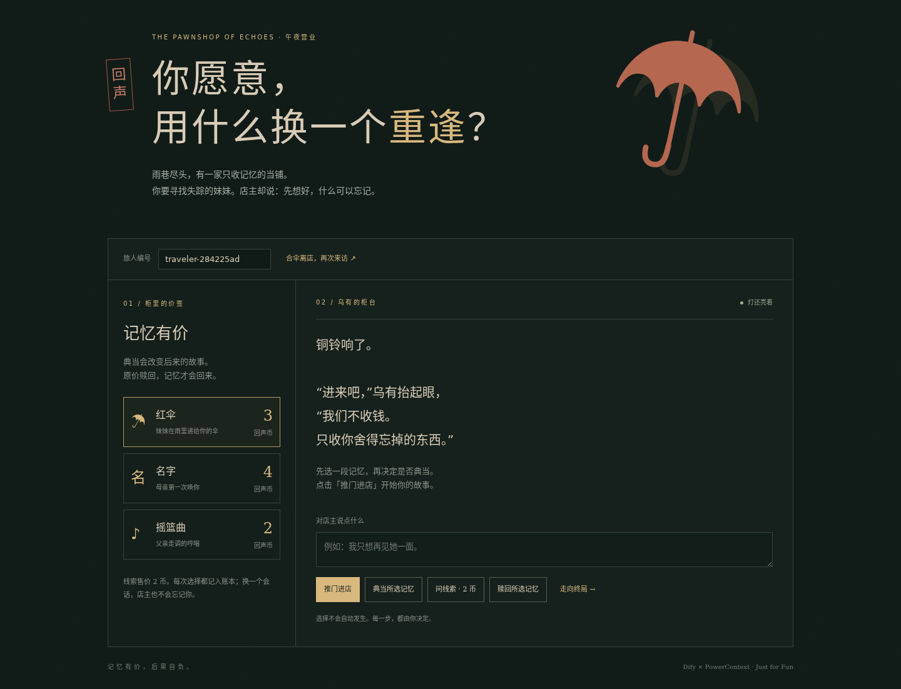

# 回声当铺：记忆有价，后果自负

你在一家只收记忆的午夜当铺寻找妹妹。典当红伞可以换到线索，却会让你认不出她；典当另一段记忆、赎回红伞，才有机会重逢。店主记住你的每一笔交易，即使你关掉页面、换一个会话或重启服务。

本作品为 OceanBase × Dify「Just for Fun」赛题原创实现。以 `oceanbase/powercontext` 的 `2026-competition-ecosystem` 分支提交 `d647275c308e09b7b623f322a26f5c4e85734fb0` 为开发基线，全部作品资产位于 `dify/`。采用 **Dify + PowerContext**，符合“至少选择一种”的要求；未声明使用 seekdb。



## 体验与验收结果

本地入口：<http://127.0.0.1:18080>。填入旅人编号，点击「推门进店」，选择记忆后典当、买线索或赎回，最后「走向终局」。相同旅人编号继续旧故事；换编号开始新故事。「合伞离店，再次来访」使用新会话编号读取旧账。

2026-11-16 完成真实运行验证：Dify 1.9.2 官方导入服务返回 `completed`；17 项端到端验收通过；12 次实际 PowerContext Source 写入、15 次读取、1 次回执复用。模型实际使用本地 Qwen2.5-1.5B-Instruct Q4_K_M，llama.cpp b7132 CPU 推理，没有使用模型响应模拟器。Dify 的 `total_tokens` 为 0，因为模型由 HTTP 配套后端调用，模型输出记录见实际事件日志。

- [完整运行说明](RUNBOOK.md)：部署、配置、DSL 导入、启动与依赖来源。
- [验收样例](ACCEPTANCE.md)：初始状态、操作顺序、预期结果与重置方式。
- [技术说明](TECHNICAL.md)：组件分工、状态隔离、一致性、限制和异常处理。
- [最终 DSL](dsl/echo-pawnshop.yml)：一个文件，无插件、知识库、Embedding 或 Rerank 依赖。
- [实际验收结果](evidence/acceptance.json)、[PowerContext 读写与模型调用记录](evidence/acceptance-events.jsonl)、[导入记录](evidence/import.json)。

## 快速启动

已验证平台：Ubuntu 22.04 x86_64 / Python 3.12 / 4 CPU 线程 / 8 GB 内存。首次下载需要网络，预计占用 4–6 GB 磁盘；模型约 1.12 GB。源码部署只监听本机，无需管理员权限、Docker 或模型 API Key。准备好 `curl`、`unzip`、`apt-get`、`dpkg-deb` 和 [uv](https://docs.astral.sh/uv/getting-started/installation/)。

```bash
cd dify
python3 scripts/native.py prepare
python3 scripts/native.py up
```

看到「回声当铺已营业」后打开网页。首次启动自动初始化 Dify、导入 DSL、发布应用并在忽略目录保存自动生成的应用凭据。停止时 Ctrl+C；重启执行同一条 `up`，已有故事保留。也支持现有 Docker Dify 或云端 Dify，见运行说明。

```bash
.venv/bin/python scripts/verify.py
.venv/bin/python -m pytest -q
```

## 来源与许可

玩法、规则、DSL、后端、界面和数据由本作品原创，未复制参考工作流；开发使用 AI 辅助。配套原创源码按 MIT 许可提供，见 [LICENSE](LICENSE)。Dify 依照其仓库 LICENSE；PowerContext 为 Apache-2.0；llama.cpp 为 MIT；Qwen2.5-1.5B-Instruct 权重按其模型卡的 Apache-2.0 使用。依赖和模型自动获取，不把第三方源码或模型权重伪装为原创资产。具体下载地址及版本见运行说明。
