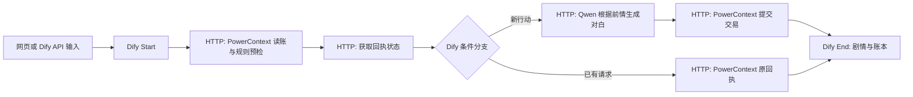

# 技术设计与要求对应

## 核心流程

Dify 承担输入定义、工具调用、条件分支、模型调用阶段、提交阶段和输出，拥有可核查的节点执行记录。浏览器只通过 `/api/play` 调用官方 `/v1/workflows/run`，无法跳过 Dify 在网页中生成故事。后台提供颗粒度明确的 HTTP 工具，不能用一个 `/play` 全包接口替代 Dify 编排。

PowerContext 实际保存并复用玩家余额、柜中记忆、线索、来访次数、行动历史、会话标识、结局和幂等回执。使用官方 `open_builtin_runtime`、`runtime.scopes.create`、`records.create_source`、`records.list_sources` 公共接口；底层为其 builtin SQLite 存储，没有自己写 SQLite 查询伪装成组件。每次成功交易追加 `kind=echo-state` 的 Source，以最大 position 读取最新状态；scope 的 idempotency_key 按旅人隔离。新 session 不改变 scope，换旅人则改变 scope。

模型通过配套后端调用真实 OpenAI 兼容接口；Dify 使用内置 HTTP Request 节点触发，故不依赖模型插件。传入最近 4 次历史与本轮规则事实，生成中文对白。系统不使用语义向量或自动记忆提炼，保存的是明确的剧情上下文/角色状态，符合 PowerContext 在题目中的用途。

## 一致性与异常

- 规则先生成候选状态，模型成功后才提交；模型不可用不扣款。不接受模型给出的金额、结局或工具指令作为规则。
- 签名票据绑定输入和基线状态版本，10 分钟过期；伪造、过期票据不写入。
- 单进程一个提交锁；提交时重读版本，两个并发不同动作只有一个能按同一版本成功，另一个要求重试。请使用 `--workers 1`，不声明支持多实例分布式并发。
- 相同 request_id + 相同输入返回 PowerContext 中已保存的原始回执；不同输入复用编号返回 409，不重复出售或扣款。
- 余额不足、重复典当等游戏内拒绝输出可理解反馈，不追加无限无效交易；成功状态最多 31 个版本（30 个普通行动后只能终局）。
- 每个 HTTP 节点配置 fail-branch，接口非 2xx 时输出错误到专用 End；网页网关校验结果并转为失败提示，避免继续解释错误正文。普通路径 7 个节点，回执路径 6 个节点。
- 模型自由对白可能不够准确；UI 独立显示权威账本裁定，验收断言基于它。更大的兼容中文模型可通过配置替换，不改变规则、DSL 或记忆接口。

## 规模与限制

读取采用 Source 分页，最多 100 条一页；当前每个玩家状态历史受回合上限约束。状态快照包括此前回执，适用于短篇试玩，写入大小随回合增长，不声明用于无限聊天或大规模生产服务。追加写和签名票据会携带快照，不包含外部知识库或上传文件。

旅人编号是演示身份标识，不是账号鉴权。请使用本机/评审隔离环境；公网多人产品需增加账号绑定和配额控制。所有本机数据库只监听回环地址，工具接口有独立密钥。网页展示文本时转义 HTML，模型文本不能注入任意标签。没有邮件、消息发送或其他外部副作用。

## 题目交付检查

| 要求 | 对应材料 |
|---|---|
| 基于指定比赛分支、资产位于 dify | Git 基线 d647275c，全部源码及材料在本目录 |
| Dify 承担核心编排且提交 DSL | dsl/echo-pawnshop.yml，官方导入/发布及实际运行证据 |
| 指定技术实际作用 | PowerContext 持久化、跨会话读取、回执复用日志 |
| 从输入、互动到反馈的完整作品 | 网页、3 段可交易记忆、线索、赎回、4 种结局 |
| 可复现配置与运行 | RUNBOOK、native.py、requirements.lock、外部来源和版本 |
| 完整样例与真实证据 | ACCEPTANCE、acceptance.json、events、截图、节点记录 |
| 数据及初始化 | 原创游戏数据直接包含 game.py；PowerContext 首次自动建 scope |
| 配套后端/前端源码 | echoes/、web/，无隐藏二进制业务逻辑 |
| 不提交真实凭据 | DSL 占位值，实际密钥和运行状态位于忽略目录 |

## 未覆盖的声明

未测试云端 Dify、其他 Dify 版本、Windows 原生部署、ARM、seekdb 或多人多实例部署。具体评测资源限制与权重题目尚未公布，不声称预测比赛分数。源码部署采用开发 Web 服务供本机评审体验，不作为公网生产部署配置。
